## Удаленный кластер k3s:
Склонировал репозиторий и подготовил доступ к удаленному кластеру k3s (в яндекс облаке):  
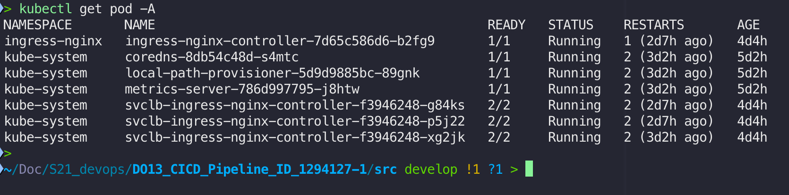  

Для GitLab Runner добавил отдельное окружение (namespace):
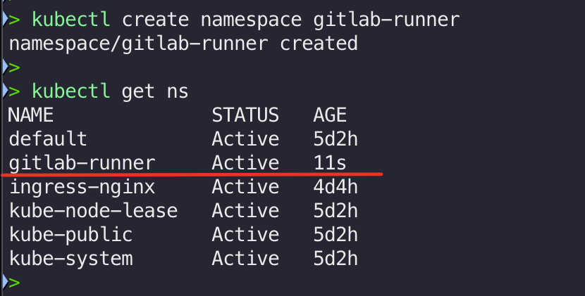  

### Secret Для хранения токена.  

Перед установкой раннера подготовил `secret`, объект для раннера хранящий *регистрационный токен* для репозитория. 
Один из вариантов выполнить команду:  

`kubectl create secret generic gitlab-runner-secret \`  
  `-n gitlab-runner \`  
  `--from-literal=runner-token=ТОКЕН`
где: 
- `create secret generic` — тип действия: создание обычного секрета с произвольными данными. (*generic*: подтип секрета, Предназначен для любых пользовательских данных в формате "ключ-значение".)
- `gitlab-runner-secret` — имя создаваемого секрета.
- `-n gitlab-runner` — указания пространства (Namespace).
- `--from-literal=`... — способ передачи секретных данных напрямую из текста.

Либо создать файл серкета: `runner-secret.yaml`:  
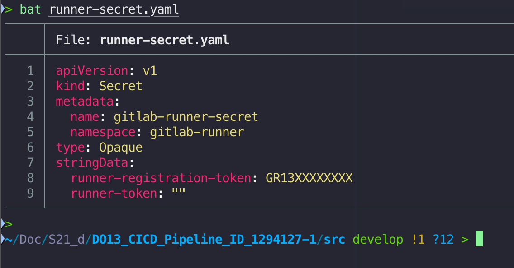  
Проверил наличие секрета в калстере и в определенном namespace:  
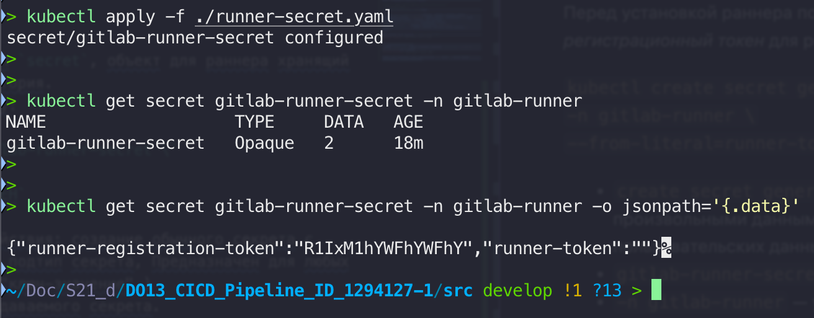  


### Конфигурационный файл
В файле `values.yaml` описал содржимое будующего `config.toml`, а так же URL  GitLab и файл секрета.  
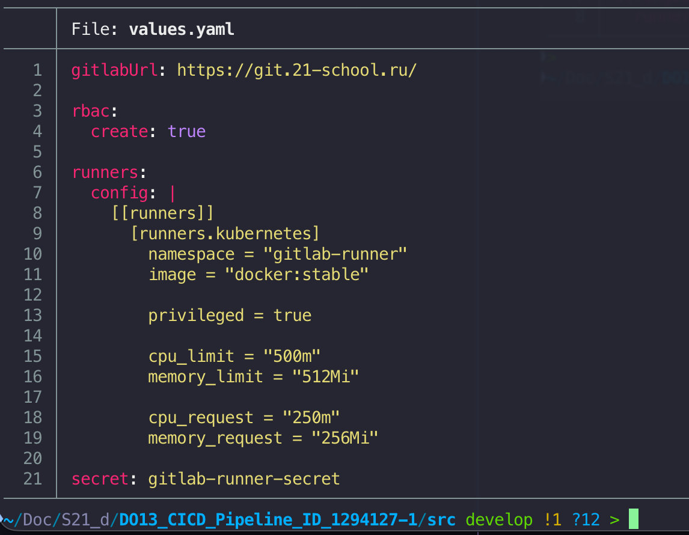  

Данный файл применится после развертывания helm чарта, и раннер должен автоматически зарегистрироваться.  

### Установка раннера из чарта:
Устанавливаю в кластер gitlab-runner командой:
`helm upgrade --install gitlab-runner gitlab/gitlab-runner \`  
 `-n gitlab-runner \`  
  `-f values.yaml`,  
где указаны нужный `namespace` (окружение) и передан файл `values.yaml`

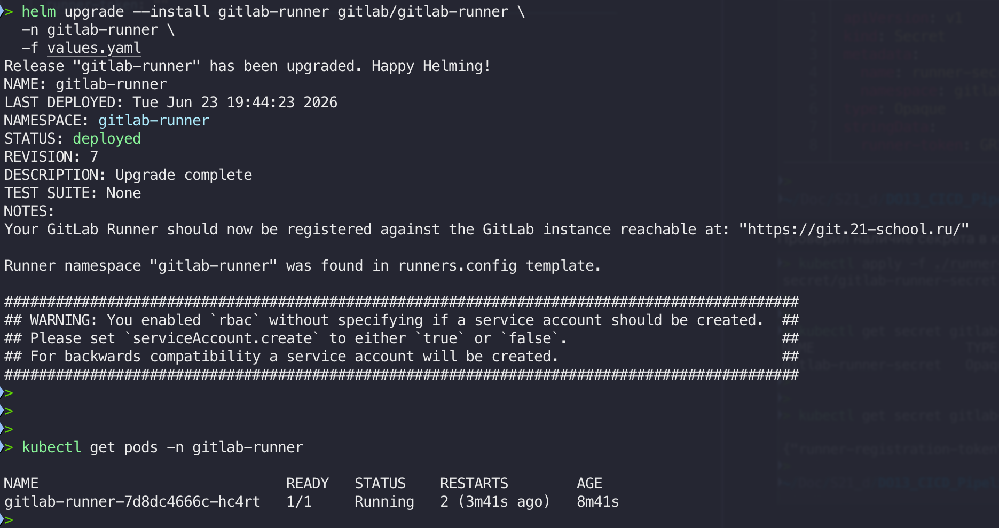  
Раннер запущен проверяю логи:  
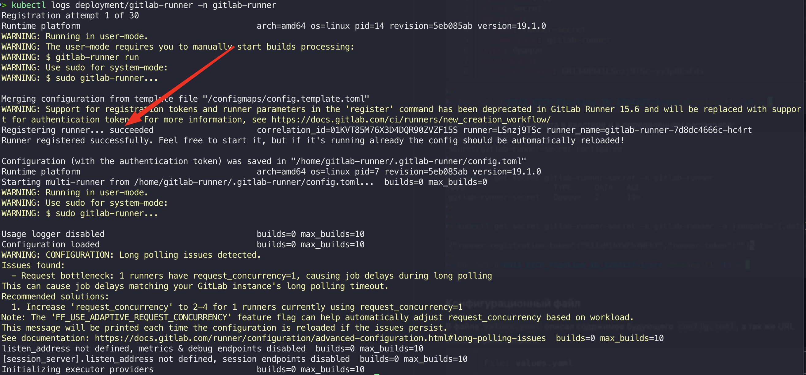  
Из лога видно что раннер успешно зарегистрирован в репозитории. 


## Пайплайны:  
### 1. Build:
Cборка приложения (запускать автоматически для веток с префиксом feature_)  
Порядок работы пайплайна:  
- Проверяет коммит был в подходящей ветке (`$CI_COMMIT_BRANCH =~ /^feature_.*/`).  
- Приверка изменений с прошлого коммита. Берем все измененные файлы, и выбирает из них только сервисы приложения (`grep '^src/services/'`)
- Генерирует список измененных сервисов.
- Проверка что изменения былм внесены в микросервисы.
- Логин в DockerHub по ключу, сборка образов и их пуш. 
- Запись в файл об актуально образе, имя и тег.
- В артефакты попадают файл с измененными сервисами, и файл актуальных в регистри образов.  

Создал токен для подключения к DockerHub 
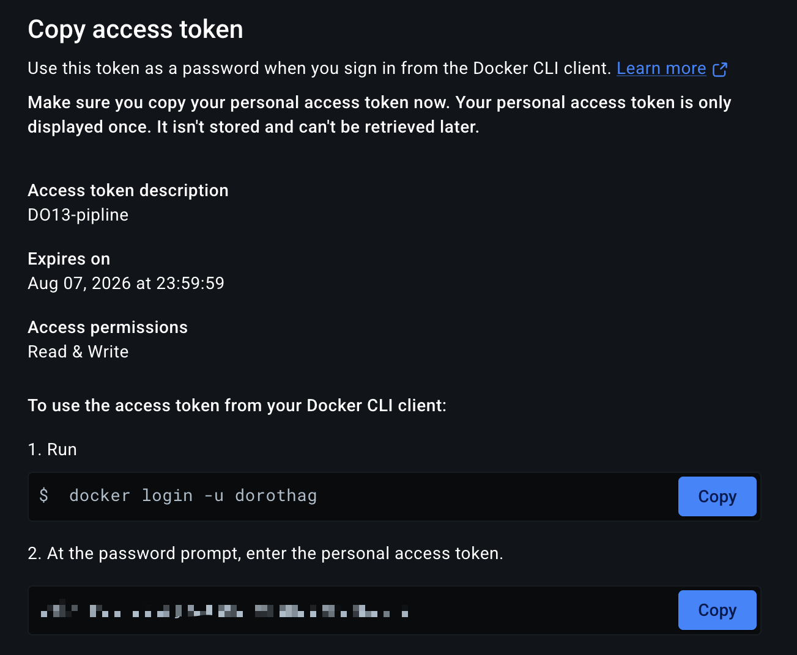  

Проверил работоспособность пайплайна на `develop` ветке:  
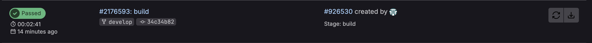  
Проверил артефакты и DockerHub:  
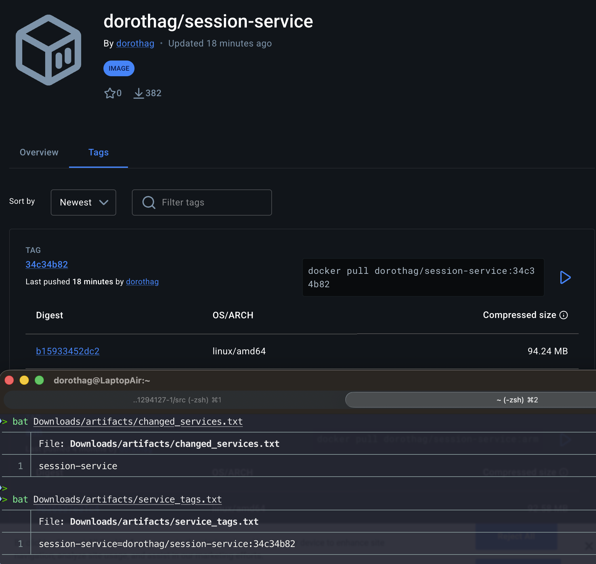  
Видно новый образ в DockerHub и корректные данные в артефактах.

### 2. Test:
Запуск функциональных тестов postman через утилиту newman (запускать автоматически для веток с префиксом feature_)  
В этой стадии использовал **Kustomize**.  
Порядок работы пайплайна:
- Зависит от стадии build, т.к будет использовать ее артефакты. (но и нечего пересобирать если build не собрал новые образы)
- Проверяет коммит был в подходящей ветке (`$CI_COMMIT_BRANCH =~ /^feature_.*/`).  
- Создает новое окружение в кластере с именем от коммита.  
- Перечитывая артефакт из прошлого этапа, редактирует файл `Kustomize/overlays/test/kustomization.yaml`  
- Собирает новый манифест (с испрпвленными образами) сохраняет в артефакты
- Запускает приложение, и проводит тесты используя шаблон из репозитория.  
- После тестов удаляет созданное окружение 
А так же добавил проверку в самом начале, если стадия **buld** не собирала и не пушила новых версий образа, то и пересобирать в **test** нечего, пайплайн пишет об этом и успешно завершается.
Проверил эту схему:  
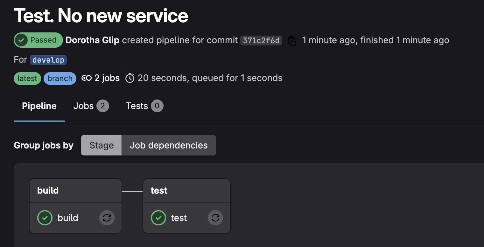  
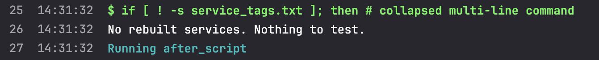    


В артефакт данного этапа сохраняется `generated.yaml` это файл итогового манифеста после kustomize build. Таким образом можно проверить теги образов, действительно ли произошла замена, отключилось ли PV для базы данных и т.д. 

В ходе тестов выявилась проблема со статическим хранилищем, т.к оно не удаляется вместе с `namespace` и при повторном запуске пайплпйна `postgres` под не запускается.  
В связи с этим для этапа **test** решил отказаться от `PV` 
Оставил в Kustomize/base без изменений, а в `Kustomize/overlays/test` добавил path, удаляющие `PVC` и `PV` и меняющий `volumes` для postgres:  
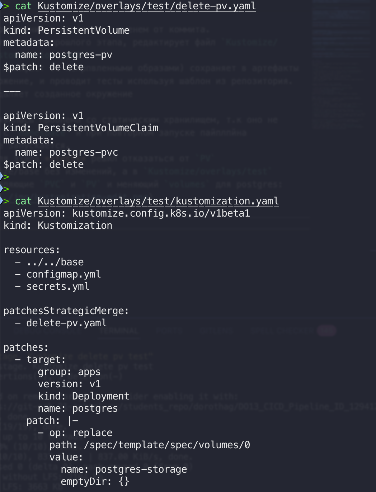  

После этого в новом namespace поднялись все поды проверил подключившись к кластеру:  
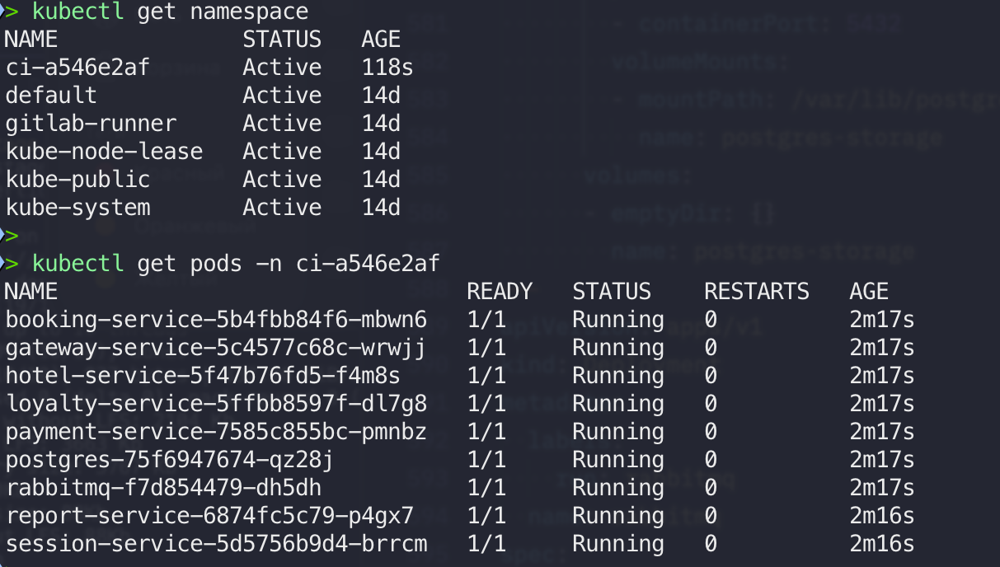  
Вывод в логах пайплайна:  
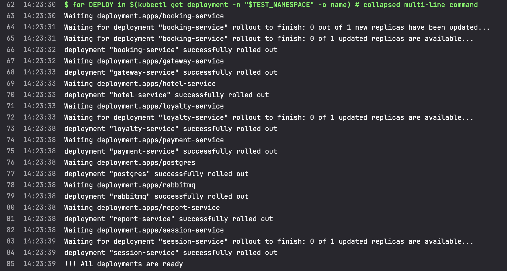  

Для запуска тестов Postman рассматривал две стратегии:  
1 - **Пайплайн запускает `pod` с `newman` внутри тестового `namespace`**   
2 - **Внутри уже работающего `pod` в `namespace` (gitlab-ci) запускается утилита newman**  
Выбрал 2 вариант, что бы не добавлять сторонние поды в тестовое окржение. Для запуска тестов пришлось изменить адреса обращения к сервисам. Вместо localhost используются DNS-имена Kubernetes вида
`service.namespace.svc.cluster.local` (см `.gitlab-ci.yml`)  

Перед тестами добавил ожидание около 3 минут, что бы все сервисы связались с БД и начали работу, после этого тесты прошли успешно:  
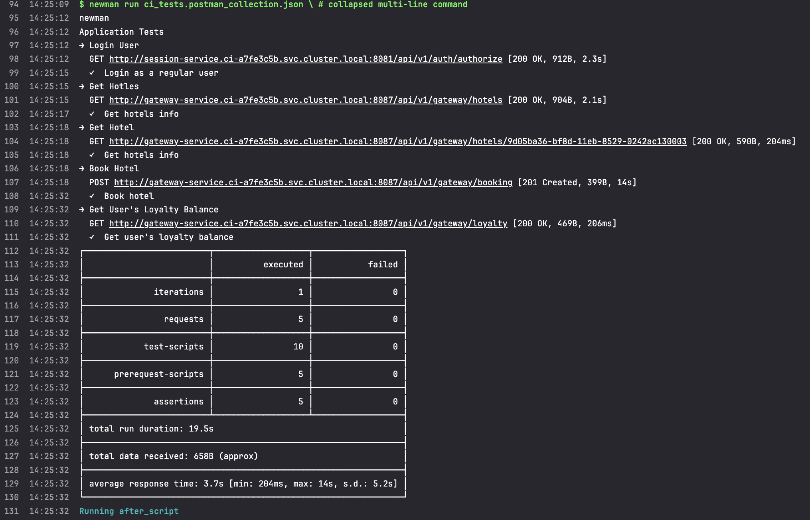  

### 3. Staging:
В этом этапе использовал `Helm` 
После стадии тестов, пайплайн подставит изменившийся тег в values, и kube заметив изменения произведет Rolling Update.  

Создал новую ветку `feature_no_change` и сделал коммит без изменения сервисов. Для проверки пайплайнов.  
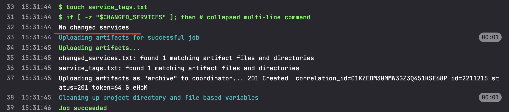  
Все выполнилось, ничего не пересобиралось, и артефакт пустой, а значит и test выполнять не будет:  
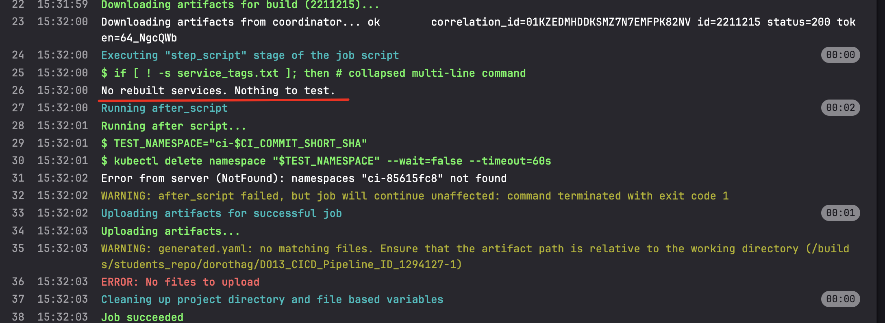  


Когда этапы build и test проверенны и работают, внес изменения в некоторые сервисы. Добавил в `pom.xml` некоторые зависимости:
- **booking-service** добавил библиотеку от Apache, которая предоставляет набор готовых инструментов для работы с текстом (строками)
```
<dependency>
    <groupId>org.apache.commons</groupId>
    <artifactId>commons-lang3</artifactId>
    <version>3.12.0</version>
</dependency>
```
- **hotel-service** добавлена библиотека, которая расширяет стандартный Java I/O
```
<dependency>
    <groupId>commons-io</groupId>
    <artifactId>commons-io</artifactId>
    <version>2.18.0</version>
</dependency>
```
- **loyalty-service** просто добавил комментарий. (т.е код не менялся, но файл обновился для gitlab)  

Этапы `buld` и `test`:  
Проверил артефакты после сборки измененных образов:  
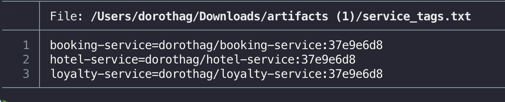  
Все те измененные сервисы, пересобранны и запшушены в DockerHub.  

Наблюдаю работу стадии test в кластере.  
  
Видно что был создан namespace и запускаются поды
Обе стадии отработали корректно, видно что kustomize заменил теги на последние актуальные:  
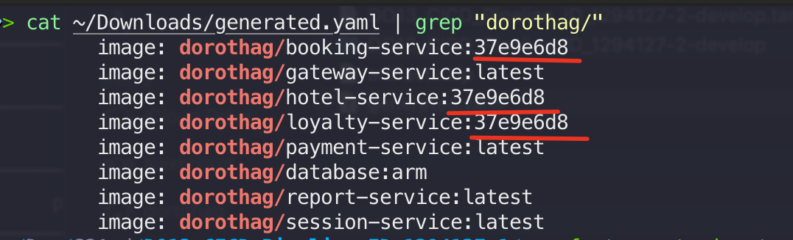  
*в рамках учебного проекта выбран более простой подход, позволяющий протестировать изменения конкретного сервиса и работу CI/CD.*  
*Потому здесь используются теги latest, что в корне не подходит для production-проектов*   

стадия Staging отработала без проблем:  
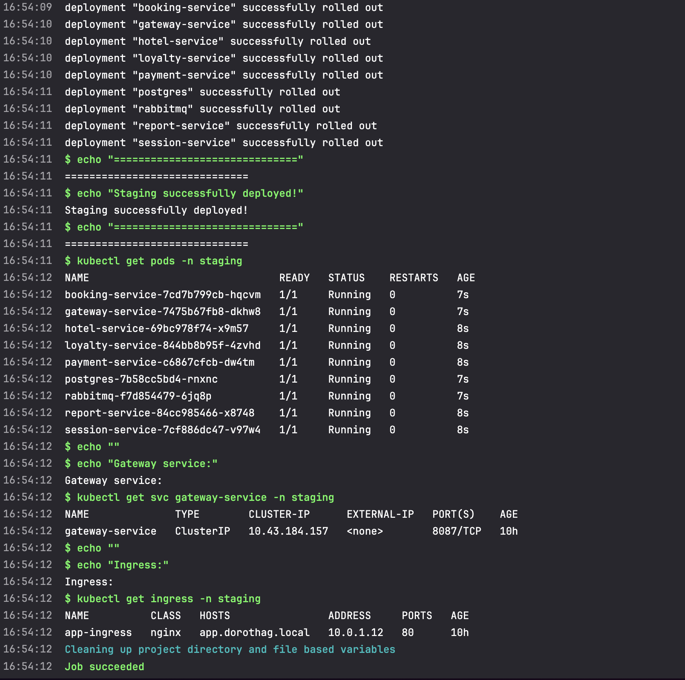  
Проверяю тег у одного из подов:  
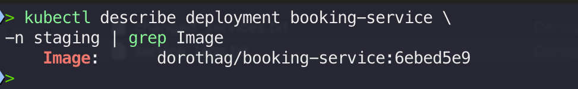  

После того как helm обновился выполнил тесты Postman (преварительно пробросил порт с ноды на хост)  
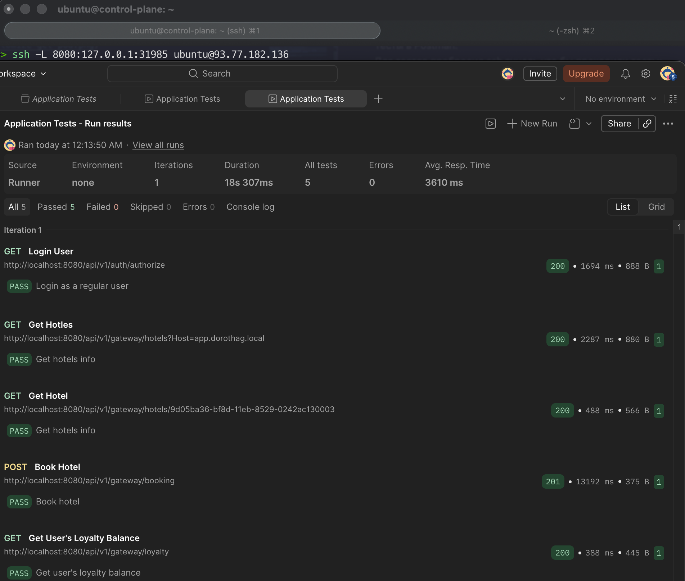  